# Восемь проектов

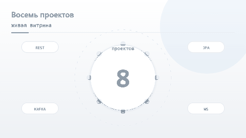

Восемь backend-проектов на Java 17 и Spring Boot 3.3 плюс витрина с анимациями и платформер из восьми
уровней. Каждый блок закрывает тему из вакансии Middle Java Developer: контракт REST, устранение N+1,
границы транзакций, многопоточность, брокер сообщений с outbox и DLQ, XML/XSD, подпись и сертификаты,
WebSocket с машиной состояний.

Вся графика в интерфейсе нарисована вручную: анимированные SVG лежат в
`src/main/resources/static/svg/`, GIF-ролики для README собраны из их кадров. Ни одной стоковой картинки.

Живая демо-версия: **[kepanasyuke.github.io/eight-projects](https://kepanasyuke.github.io/eight-projects/)** —
статическая сборка для GitHub Pages. Backend там нет, поэтому игра работает офлайн, а лидерборд хранится
в `localStorage` браузера.

## Быстрый старт

```bash
./mvnw spring-boot:run      # H2 в режиме PostgreSQL, миграции Flyway применяются на старте
# или
./mvnw package && java -jar target/eight-projects.jar
```

Приложение поднимается на `http://localhost:8080`:

| Адрес | Что там |
| --- | --- |
| `/` | рабочая консоль: задачи, JPA, транзакции, потоки, брокер, XML, подпись, WebSocket |
| `/showcase.html` | витрина: восемь карточек с SVG-анимациями и живыми данными |
| `/projects/p1.html` … `/projects/p8.html` | страница проекта: задача, решения, вызов API, фрагмент кода |
| `/game.html` | платформер из восьми уровней и таблица лидеров |
| `/actuator/health` | состояние приложения |
| `/api/showcase/projects` | JSON витрины (единый источник правды для страниц) |

### Консоль

Главная страница — не презентация, а рабочий интерфейс к тем же эндпоинтам, которые дергают тесты.
Раздел «Задачи» делает полный цикл: фильтр по статусу, пагинация, создание с `Idempotency-Key`,
редактирование, заметки, удаление и смена статуса только по разрешённым переходам машины состояний.
Остальные разделы запускают соответствующие сценарии и показывают ответ сервера как есть:

| Раздел | Что делает |
| --- | --- |
| Задачи | CRUD `/api/v1/work-items`, список заметок, переходы по статусам |
| JPA-запросы | прогоняет naive / fetch join / EntityGraph / проекцию и сравнивает число SQL |
| Транзакции | переводы между счетами, откат с аудитом в `REQUIRES_NEW`, проводки и журнал |
| Потоки | параллельные вызовы, тайм-аут, гонка счётчиков, дедлок, перегрузка пула |
| Брокер | сценарий доставки с повторами и DLQ, состояние партиций, запись в outbox |
| XML и XSD | валидация, разбор JAXB, сборка счёта и попытка XXE |
| Подпись | подпись, проверка, подмена нагрузки, сертификат и цепочка |
| WebSocket | живое соединение с машиной состояний и журнал кадров |
| Игра | статистика и лидерборд, переход в платформер |

### PostgreSQL вместо H2

```bash
docker compose up -d          # postgres:16-alpine, база eight
./mvnw spring-boot:run -Dspring-boot.run.profiles=postgres
```

Профиль `postgres` меняет только datasource: схема и миграции те же, что и для H2.

## Что внутри

| № | Проект | Ключевые решения | Эндпоинты |
| --- | --- | --- | --- |
| 1 | REST API по контракту | DTO отделены от сущности, `@Valid`, пагинация, идемпотентность по `Idempotency-Key`, единый `ApiError` | `/api/v1/work-items` |
| 2 | JPA без N+1 | naive / fetch join / EntityGraph / DTO-проекция, `@Version`, `SELECT FOR UPDATE`, статистика Hibernate | `/api/v2/jpa/*` |
| 3 | Границы транзакций | `REQUIRED`, `REQUIRES_NEW` в отдельном бине, откат перевода, демонстрация self-invocation | `/api/v3/tx/*` |
| 4 | Многопоточность | пул 8/64 с `AbortPolicy`, `orTimeout`, гонка `long` против `AtomicLong`, дедлок и его лечение | `/api/v4/concurrency/*` |
| 5 | Брокер и Outbox | партиции, группы, оффсеты, ограниченные повторы, DLQ, дедупликация, Transactional Outbox | `/api/v5/bus/*` |
| 6 | XML и XSD | JAXB с явным namespace, `include` схем, валидация `SchemaFactory`, запрет DTD и внешних сущностей | `/api/v6/xml/*` |
| 7 | Подпись и сертификаты | `Signature` через JCA, PKCS12 KeyStore, X.509, проверка срока и цепочки, демонстрация подмены | `/api/v7/crypto/*` |
| 8 | WebSocket и состояния | `TextWebSocketHandler`, лимит размера сообщения, валидация переходов, освобождение сессий | `ws://localhost:8080/ws/state`, `/api/v8/ws/schema` |

Игровой модуль: `/api/game/levels`, `POST /api/game/scores`, `GET /api/game/leaderboard`,
`GET /api/game/stats`.

## Скриншоты

| Консоль: задачи | Консоль: транзакции |
| --- | --- |
| 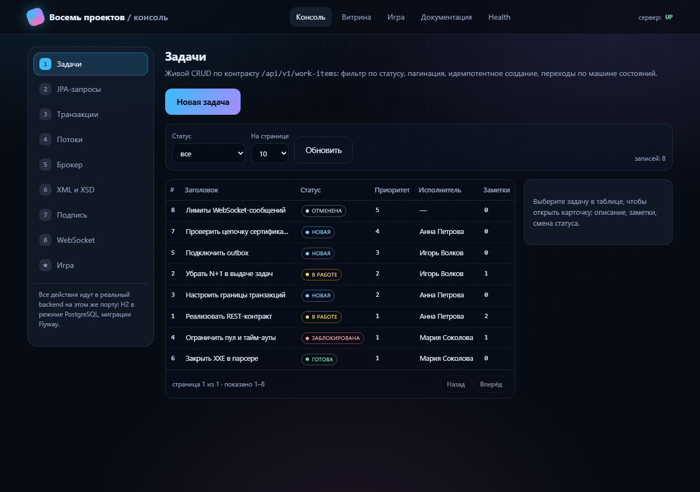 | 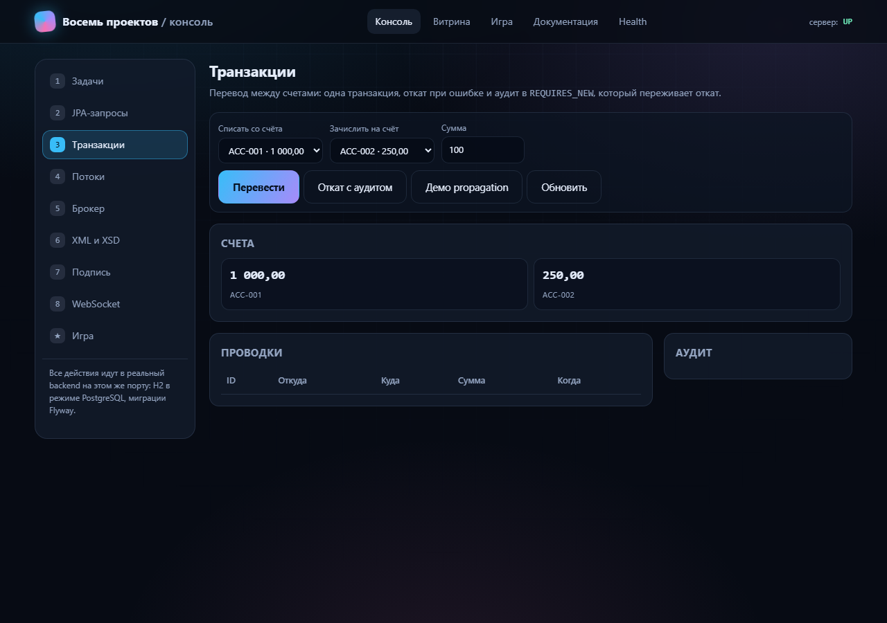 |

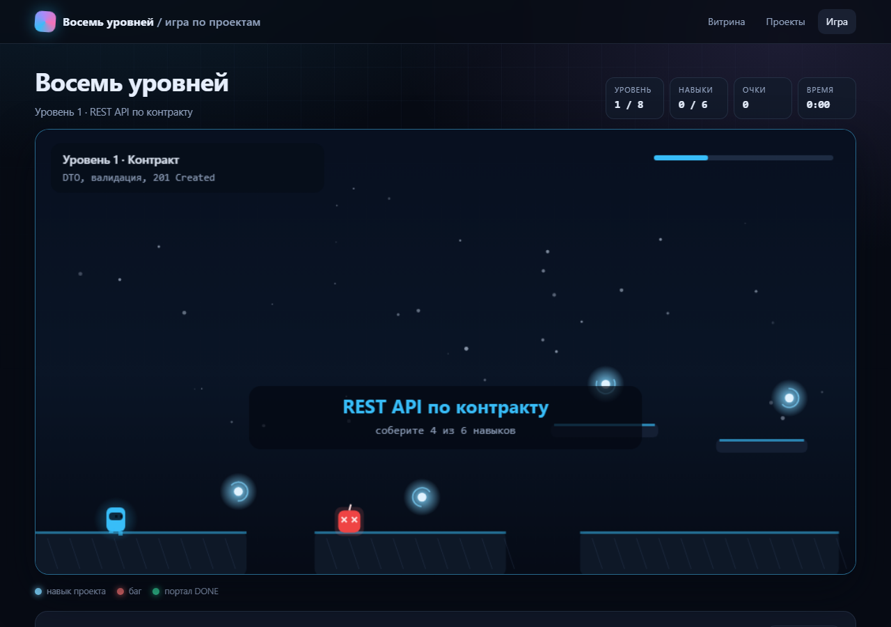

## Демо

Анимации выше — это те же SVG, что показывает витрина; GIF собраны из их кадров.

| | |
| --- | --- |
| 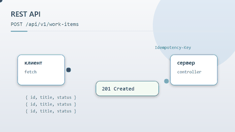 REST: идемпотентность | 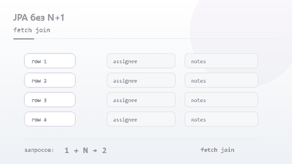 JPA: число запросов падает |
| 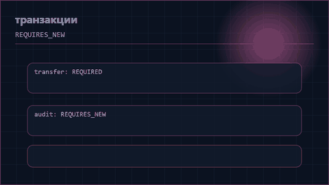 Транзакции: commit и rollback | 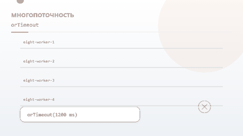 Пул, таймауты, гонки |
| 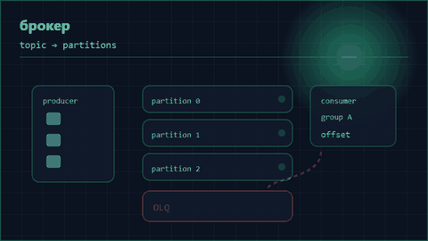 Брокер: партиции и DLQ | 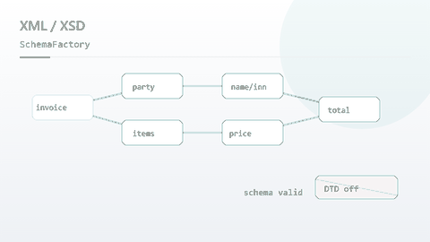 XML: сборка дерева и XSD |
| 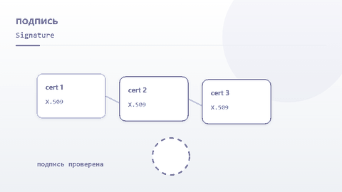 Подпись и цепочка сертификатов | 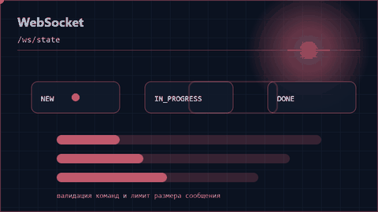 WebSocket: переходы состояний |

## Структура

```
src/main/java/ru/eight
├── common/      ApiError, ApiException, GlobalExceptionHandler, PageResponse
├── domain/      WorkItem, Assignee, WorkNote, WorkItemStateMachine, репозитории
├── p1rest/      REST-контракт, идемпотентность
├── p2jpa/       варианты загрузки связей и отчёты о запросах
├── p3tx/        счета, переводы, аудит в отдельной транзакции
├── p4conc/      пул, CompletableFuture, гонки, дедлок
├── p5bus/       in-memory брокер с семантикой Kafka и outbox
├── p6xml/       JAXB-модель, валидация XSD, защита парсера
├── p7crypto/    подпись, проверка, паспорт сертификата
├── p8ws/        WebSocket и машина состояний
├── game/        уровни, результаты, лидерборд
└── showcase/    метаданные витрины

src/main/resources
├── db/migration/    Flyway: схема, демо-данные, правка ограничений
├── xsd/             invoice.xsd + common-types.xsd
├── crypto/          демо-хранилище PKCS12
└── static/          витрина, страницы проектов, игра, ассеты, SVG

docs/demo/           GIF-ролики, собранные из кадров SVG
docs/screenshots/    скриншоты консоли и игры для README
docs/                статическая сборка для GitHub Pages: лендинг и игра
tools/               генераторы SVG, GIF, страниц и сборка docs/
```

Генераторы идемпотентны и лежат в репозитории:

```bash
python tools/make_svgs.py        # 9 анимированных SVG (SMIL) в static/svg
python tools/make_demo_gifs.py   # GIF для README из кадров SVG (нужен Chrome или Edge)
python tools/make_pages.py       # HTML страниц проектов из общего словаря метаданных
python tools/build_pages.py      # docs/: игра с относительными путями и офлайн-лидербордом
```

## Тесты

```bash
./mvnw test
```

511 тестов, все зелёные. Кроме сквозного `ApiIntegrationTest` на MockMvc добавлены матричные наборы,
которые перебирают варианты поведения, а не только счастливый путь:

| Набор | Что проверяет |
| --- | --- |
| `WorkItemStateMachineMatrixTest` | все пары «состояние → команда», включая запрещённые |
| `XmlValidationMatrixTest` | допустимые и недопустимые значения XSD, XXE и DOCTYPE |
| `StateCommandMatrixTest` | разбор команд WebSocket, лимиты сообщений |
| `RestContractMatrixTest` | коды ответов и тела ошибок по каждому эндпоинту |
| `BoundarySweepTest` | граничные значения параметров: нули, отрицательные, максимумы |
| `PatternSweepTest` | регулярные выражения и форматы полей |
| `GameApiMatrixTest` | уровни, результаты, лидерборд |
| `JpaModeMatrixTest` | все режимы загрузки связей и число запросов |
| `LedgerMatrixTest` | переводы, откаты, аудит в `REQUIRES_NEW` |
| `BusMatrixTest` | партиции, повторы, DLQ, дедупликация |
| `CryptoCasesTest` | подпись, подмена, просроченный сертификат |
| `ConcurrencyMatrixTest` | гонки, таймауты, дедлок |
| `VitrinaStaticTest` | отдача страниц, JS и SVG, доступность витрины |

## Правила стиля

Код держится в одном стиле, проверенном по всему `src/main`:

- у метода один `return` в конце: ранние выходы заменены предикатом в заголовке цикла или `Stream`;
- нет `break`, `continue` и `while` — только `for` с единственной точкой выхода;
- методы короче 30 строк, классы без Lombok: геттеры и сеттеры пишутся явно;
- ошибки отдаются через единый `ApiError`, обработчики собраны в `GlobalExceptionHandler`;
- тесты читают тело через `getContentAsString(StandardCharsets.UTF_8)`, иначе ломается кириллица.

## Ограничения и допущения

- **КриптоПро.** Демо работает на стандартном JCA-провайдере с RSA-ключом из ресурсов, чтобы проект
  запускался без лицензии. Для ГОСТ достаточно подключить провайдера JCP/JCSP и указать его алгоритм
  в `eight.crypto.signature-algorithm` — код сервиса менять не нужно.
- **Брокер.** Реализована in-memory модель с семантикой Kafka (партиции, группы, оффсеты, retry, DLQ,
  дедупликация), а не клиент настоящего кластера: цель — воспроизводимая демонстрация поведения.
- **База.** По умолчанию H2 в режиме PostgreSQL; для реального PostgreSQL есть профиль `postgres`
  и `docker-compose.yml`.
- **Демо-хранилище.** `src/main/resources/crypto/demo-keystore.p12` — учебный PKCS12 с паролем
  `changeit`, никаких реальных ключей в репозитории нет.
